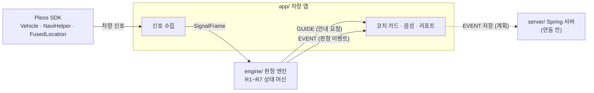

# Driver Sense

**단속되기 전에, 습관부터.**

Driver Sense는 차량 신호로 운전 법규 습관을 진단하고, 놓치기 쉬운 순간을 단속되기 전에 미리 알려주는 Pleos Connect 차량용 앱입니다. 현대자동차그룹 차량용 앱 개발 공모전(Pleos Playground) 출품작입니다.

- 방향지시등, 기어, 속도, 내비의 다음 안내(TBT) 같은 **차량 신호**로 법규 판정을 차 안에서 바로 합니다.
- 판정 지점 몇 초 전에 깜빡이나 전조등이 꺼져 있으면 **음성 한 문장과 작은 카드**로 알려줍니다.
- 기어를 P에 두면 지킨 것과 놓친 것을 **법 조항·처분과 함께** 보여줍니다.

## 목차

1. [주요 기능](#주요-기능)
2. [동작 흐름](#동작-흐름)
3. [구조](#구조)
4. [기술 스택](#기술-스택)
5. [빌드와 실행](#빌드와-실행)
6. [현재 한계](#현재-한계)
7. [문서 안내](#문서-안내)
8. [협업 규칙](#협업-규칙)

## 주요 기능

| 기능 | 설명 |
| --- | --- |
| 주행 중 예방 안내 | 판정 지점에 다가가는데 깜빡이·전조등 등이 꺼져 있으면 음성 한 문장과 코치 카드로 알려줍니다. 켜면 카드가 "좋아요"로 바뀝니다. 켜는 방법은 레버·버튼 그림으로 함께 보여줍니다. |
| 내비 위 안내 | 주행 중에는 내비가 화면을 차지하므로, 안내가 필요한 순간에만 내비 위에 작은 팝업 카드를 띄웠다가 지웁니다. |
| 법규 판정 | 판정 엔진이 룰 7개(R1~R7)를 프레임마다 검사해 지킴(KEPT)·놓침(MISSED)을 기록합니다. |
| 오늘 주행 리포트 | 기어를 P에 두면 오늘 지킨 곳과 놓친 곳, 해당 법 조항과 처분, 안내 덕분에 아낀 범칙금을 보여줍니다. |
| 목적지 경로 코치 | 내비에서 목적지를 정하면 그 경로를 따라가며 코치합니다. 출발 전에는 경로 미리보기(코치할 곳 수, 경로 순서, 자주 놓친 유형)를, 도착하면 그 경로의 판정만 묶은 경로 리포트를 보여줍니다. |
| 법규 Q&A | 법규 룰 테이블(15개 항목)에서 근거를 찾아 답하고, 조항·처분·출처를 근거 카드로 보여줍니다. 경로 리포트의 "AI에게 묻기"로 바로 물어볼 수 있습니다. |
| 진단 리포트·습관 선택 | 상황별 준수율을 전국 평균(75.7%)과 비교해 보여주고, 고칠 습관을 최대 2개 고릅니다. |
| 교정 진행 | 주간 준수율 추이, 습관별 졸업 진행, 자주 놓친 곳을 보여줍니다. |
| 운전 코치 켬/끔 | 스위치 하나로 안내를 켜고 끕니다. 꺼도 판정 기록은 계속 남습니다. |

진단 리포트와 교정 진행의 수치, 법규 Q&A의 답변 방식은 아직 개발 중인 부분이 있습니다. [현재 한계](#현재-한계)에 정리했습니다.

### 판정 룰

| 룰 | 상황 | 안내 문구 | 법 근거 |
| --- | --- | --- | --- |
| R1 | 회전 전 깜빡이 | 좌회전 곧이에요, 깜빡이 켜세요 | 도로교통법 제38조 |
| R2 | 깜빡이 없이 회전 (내비 없이) | 없음 (기록만) | 도로교통법 제38조 |
| R3 | 적색 신호 우회전 일시정지 | 전방 적색이에요, 정지선에서 멈췄다 가세요 | 도로교통법 제5조 |
| R4 | 나들목 진출입 전 깜빡이 | 오른쪽 나들목이 곧이에요, 깜빡이 켜세요 | 도로교통법 제38조 |
| R5 | 터널 진입 전 전조등 | 터널이 곧 나와요, 전조등 켜세요 | 도로교통법 제37조 |
| R6 | 비 올 때 와이퍼 | 비가 와요, 와이퍼 켜세요 | 없음 (안전 안내) |
| R7 | 앞유리 김서림 | 앞유리가 뿌예질 수 있어요, 성에 제거를 켜고 외기로 바꾸세요 | 없음 (안전 안내) |

판정 규칙(상태 머신, 파라미터, 전이표)은 [docs/spec.md](docs/spec.md), 법 조항과 처분의 출처는 [docs/law_table.md](docs/law_table.md)에 있습니다.

## 동작 흐름

**진단 → 코치 → 리포트 → 법규 Q&A** 순서로 이어집니다.

1. **진단**: 정차 중(기어 P) "진단·습관" 화면에서 상황별 준수율을 보고, 고칠 습관을 고릅니다.
2. **코치**: 출발하면 화면은 내비가 차지하고, 앱은 뒤에서 차량 신호를 판정 엔진에 한 프레임씩 넣습니다. 회전·나들목·터널 같은 판정 지점에 다가가는데 깜빡이나 전조등이 꺼져 있으면, 음성 한 문장과 내비 위 카드로 알려줍니다. 운전자가 켜면 카드가 "좋아요"로 바뀌고 곧 사라집니다.
3. **리포트**: 도착해 기어를 P에 두면 앱이 앞으로 와서 리포트를 보여줍니다. 놓친 곳을 먼저 보여주고, 각 판정에 법 조항과 처분을 붙입니다.
4. **법규 Q&A**: 리포트를 보다 궁금한 점은 "AI에게 묻기"로 넘어가 물어봅니다. 답은 룰 테이블에 있는 근거 안에서만 만들고, 근거가 없으면 "확인된 근거가 없어요"라고 답합니다.

주행 중에는 화면을 터치할 일이 없습니다. 리포트, 진단, 습관 선택, 교정 진행, Q&A, 코치 켬/끔 화면은 기어 P에서만 열립니다.

## 구조

앱, 판정 엔진, 서버를 한 저장소에서 개발합니다.



- 판정은 차 안(앱)에서 바로 합니다. LLM을 쓰지 않고 규칙(상태 머신)으로만 판정해서, 같은 주행에는 항상 같은 결과가 나옵니다.
- 판정 엔진은 Android에 의존하지 않는 순수 Kotlin 라이브러리입니다. 차량이나 에뮬레이터 없이 모든 판정을 자동으로 시험합니다.

| 폴더 | 내용 | 담당 | 상태 |
| --- | --- | --- | --- |
| [engine/](engine/README.md) | 판정 엔진 (순수 Kotlin 라이브러리) | AI 담당 | R1~R7 동작 |
| `scenarios/` | 주행 시나리오 JSON (엔진 테스트와 앱 데모 공용) | AI 담당 | S1~S24 |
| [app/](app/README.md) | Pleos Connect 차량 앱 | 앱 담당 | 주행 코치, 내비 위 안내, 리포트, 경로 코치, 진단·습관 선택, 교정 진행, 법규 Q&A, 운전 코치 켬/끔 |
| [server/](server/README.md) | Spring 서버 (판정 이벤트 저장, 리포트 API) | 서버 담당 | 개발 중 (앱과 아직 연결 전) |
| `data/` | 법규 룰 테이블 (조항·처분·출처) | AI 담당, 서버 담당 | 15개 항목 |
| [docs/](#문서-안내) | 기획서, 엔진 명세, 작업 순서 | PM, AI 담당 | |
| [apk/](apk/README.md) | 제출용 APK | 앱 담당 | |

## 기술 스택

| 구분 | 사용 기술 |
| --- | --- |
| 언어·빌드 | Kotlin 2.4, Gradle (Kotlin DSL, Wrapper 포함), JDK 17 |
| 차량 앱 | Android Automotive (minSdk 28), Android View·XML 레이아웃, 포그라운드 서비스 |
| Pleos SDK | Vehicle 2.3.2, NaviHelper 3.0.5, FusedLocation 1.1.3, TextToSpeech 3.3.1 |
| 차량 속성 | `android.car`의 `CarPropertyManager` (속도) |
| 판정 엔진 | 순수 Kotlin JVM 라이브러리, `kotlinx-serialization-json` |
| 지도 | 네이버 지도 Android SDK 3.24.1 (경로 데모의 앱 안 지도) |
| 테스트 | JUnit 5, `kotlin-test`. 시나리오 JSON으로 엔진 출력을 기대값과 비교 |
| 서버 | Spring (개발 중) |

## 빌드와 실행

### 테스트 환경

| 항목 | 버전·설정 |
| --- | --- |
| 실행 환경 | Pleos Connect Emulator v2.1.0 (2560×1440, 160dpi) |
| 빌드 | JDK 17, Android SDK (`local.properties`의 `sdk.dir` 또는 `ANDROID_HOME`) |
| Pleos SDK 저장소 | `https://nexus-playground.pleos.ai/repository/maven-releases/` |
| 네이버 지도 | 경로 데모 지도에만 씁니다. `local.properties`에 `NAVER_MAP_CLIENT_ID`를 적습니다 ([app/README.md](app/README.md#네이버-지도)). 없어도 빌드되고, 지도만 안 뜹니다 |
| 권한 | 위치(`pleos.car.permission.FUSED_LOCATION`)와 속도(`android.car.permission.CAR_SPEED`)는 앱을 처음 켤 때 묻습니다 |

### APK로 실행

제출용 release APK는 [apk/](apk/README.md) 폴더에 둡니다. 파일 이름은 `팀명_앱이름_release.apk`입니다.

1. Pleos Connect Emulator를 켭니다.
2. APK를 설치하고 실행합니다.

   ```bash
   adb install -r apk/팀명_앱이름_release.apk
   adb shell am start --user 10 -n kkam.app/.MainActivity
   ```

3. 처음 켤 때 위치·속도 권한을 허용하면 실제 차량 신호로 주행 코치를 시작합니다.
4. 기어, 방향지시등, 속도는 에뮬레이터의 Virtual Console에서 바꿉니다. 아래 명령 뒤 브라우저로 `http://127.0.0.1:8088/`을 엽니다. 기어를 P로 바꾸면 오늘 주행 리포트가 나옵니다.

   ```bash
   adb forward tcp:8088 tcp:8088
   ```

5. 내비 위 안내 카드는 "다른 앱 위에 표시" 권한이 있어야 뜹니다. 에뮬레이터에는 이 설정 화면이 없어서 아래 명령으로 켭니다. 권한이 없으면 같은 내용을 상단 알림으로 보여줍니다.

   ```bash
   adb shell appops set --user 10 kkam.app SYSTEM_ALERT_WINDOW allow
   ```

### 소스에서 빌드

저장소를 받은 폴더에서 실행합니다.

```bash
./gradlew test :app:testDebugUnitTest   # 엔진·앱 단위 테스트와 시나리오 테스트
./gradlew :app:installDebug             # 에뮬레이터에 debug 앱 설치
```

Android SDK 위치(`ANDROID_HOME` 또는 `local.properties`의 `sdk.dir`)가 없으면 `./gradlew test`도 실패합니다. 엔진만 시험하려면 `./gradlew :engine:test`를 씁니다.

### 데모로 주행 장면 보기

에뮬레이터의 내비는 경로를 설정해도 위치가 움직이지 않습니다. 그래서 주행 장면은 녹화된 차량 신호(`scenarios/`)를 앱에 재생해서 보여줍니다. 판정 엔진은 실제 차량 신호와 재생 신호를 똑같이 처리합니다.

debug 앱은 오른쪽 위 "데모" 버튼으로 데모 패널을 엽니다. release 앱에는 이 버튼이 없습니다.

**시나리오 재생.** 시나리오를 누르면 녹화된 주행 신호를 시간대로 재생합니다.

| 시나리오 | 보이는 것 |
| --- | --- |
| S2 좌회전 안내후 켬 | 좌회전 60m 앞 "좌회전 곧이에요, 깜빡이 켜세요" → 깜빡이를 켜면 파랑 "좋아요" → 회전 후 지킴 기록 |
| S3 좌회전 끝까지 안켬 | 안내 후에도 안 켜서 놓침 기록 |
| S8 판정후 주차 | 기어 P에서 오늘 주행 리포트(지킴·놓침, 조항·처분, 아낀 범칙금) |
| S11 터널 전조등 | 터널 187m 앞 "터널이 곧 나와요, 전조등 켜세요" → 켜면 지킴 기록 |
| S12 나들목 안내후 켬 | 오른쪽 나들목 167m 앞 깜빡이 안내와 레버 그림 → 100m 지점에서 지킴 기록 |

시나리오 전체 목록(S1~S24)과 기대 출력은 [docs/spec.md](docs/spec.md) 4장에 있습니다.

**경로 데모.** 데모 패널의 "경로 데모 (목적지 검색 → 도착)"는 목적지 경로 코치를 처음부터 끝까지 약 3분에 보여줍니다. 시연용 경로 데이터를 재생하며, 목적지 검색 → 경로 미리보기 → 주행 중 안내와 판정 → 도착 후 경로 리포트 → "AI에게 묻기" 순서로 진행합니다. 자세한 내용은 [app/README.md](app/README.md#데모-패널)에 있습니다.

**내비 위 안내 보기.** 데모 패널의 "재생하면 내비 띄우기"를 켜면 내비를 앞에 둔 채 내비 위 안내 카드를 볼 수 있습니다.

## 현재 한계

심사자가 실행해 볼 때 헷갈리지 않도록, 아직 완성되지 않은 부분을 적습니다.

- **법규 Q&A**는 지금 룰 테이블의 키워드 매칭으로 답합니다. LLM(Gleo AI) 연결과 음성 질문(STT)은 아직 붙이지 않았습니다. 질문은 글로 입력하거나 추천 질문을 누릅니다.
- **진단 리포트와 교정 진행**의 수치는 데모 데이터입니다. 고른 습관은 아직 엔진의 안내 규칙에 반영되지 않습니다.
- **서버**는 앱과 연결되기 전입니다. 판정 기록은 차량 기기에 저장하고, 오늘 것만 유지합니다.
- **실제 차량 신호**로 달릴 때는 전방 신호등 정보와 비 정보가 아직 들어오지 않습니다. 그래서 R3(적색 우회전), R6(와이퍼), R7(김서림)은 시나리오 재생에서만 확인할 수 있습니다.
- **에뮬레이터**에서는 내비 위치가 움직이지 않아, 실제 신호로는 회전 완료까지의 판정을 확인할 수 없습니다. 주행 장면은 데모 패널로 확인합니다.

## 문서 안내

처음 보는 분은 위에서부터 읽으면 됩니다.

| 문서 | 내용 |
| --- | --- |
| [docs/proposal.md](docs/proposal.md) | 서비스 기획서. 문제 정의, 타깃, 기능 명세, 심사 기준별 설명 |
| [docs/proposal-tech.md](docs/proposal-tech.md) | 기술·AI 활용 요약. 판정을 규칙으로 하는 이유, 검증 방법, SDK 사용 계획 |
| [docs/spec.md](docs/spec.md) | 판정 엔진 명세. 입출력 형식, 룰별 상태 머신과 전이표, 시나리오. 엔진 동작의 기준 문서 |
| [docs/law_table.md](docs/law_table.md) | 법규 룰 테이블 설명. 필드, 원문 대조 결과, 미확인 항목 |
| [engine/README.md](engine/README.md) | 판정 엔진 사용법과 시나리오 목록 |
| [app/README.md](app/README.md) | 차량 앱의 화면, 데모 패널, 코드 구조, SDK 연동 |
| [server/README.md](server/README.md) | 서버 계획 |
| [apk/README.md](apk/README.md) | 제출용 APK 위치와 설치 방법 |
| [docs/tasks.md](docs/tasks.md) | 판정 엔진 개발 단계 기록 (팀 내부용) |

## 협업 규칙

- `main`은 항상 빌드되는 상태로 둡니다. 직접 푸시하지 않습니다.
- 작업 브랜치에서 개발하고 작은 PR로 합칩니다. 브랜치 이름은 `engine/r2`, `app/coach-card`, `server/event-api`처럼 폴더 이름으로 시작합니다.
- 다른 담당자의 폴더를 고칠 때는 담당자에게 먼저 알립니다.
- 엔진 입출력 형식을 바꿀 때는 `docs/spec.md`를 먼저 고치고 앱·서버 담당자에게 공유합니다.
- 비밀 값(API 키, `local.properties`, 서명 키)은 커밋하지 않습니다.

### 실명 쓰지 않기 (공모전 제출 규정)

공모전 심사 자료와 제출 링크에는 개발자 실명, 계정 정보, 개인정보가 보이면 안 됩니다. 이 저장소의 파일은 그대로 제출본이 되므로 아래를 지킵니다.

- 코드, 주석, TODO, 문서, 앱 화면 문구에 팀원 실명, GitHub 계정 이름, 개인 이메일을 쓰지 않습니다. 대신 역할명(AI 담당, 앱 담당, 서버 담당, PM)을 씁니다.
- 시연 영상과 화면 캡처에도 이름, 계정, 개인 폴더 경로, 메신저 알림이 보이지 않게 합니다.
- 제출용 저장소는 제출 직전에 이 저장소의 `main`을 복사해 따로 올립니다. 제출용 저장소에는 각자 커밋하지 않습니다. 커밋하면 개인 계정 이름이 기록에 남기 때문입니다.
- 커밋 메시지와 PR 본문은 제출본에 복사되지 않으므로 이름을 써도 됩니다.
